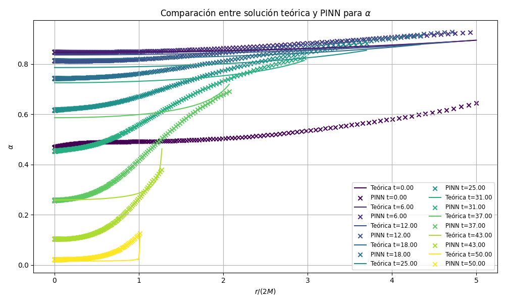
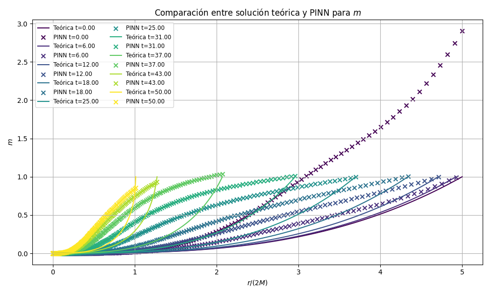
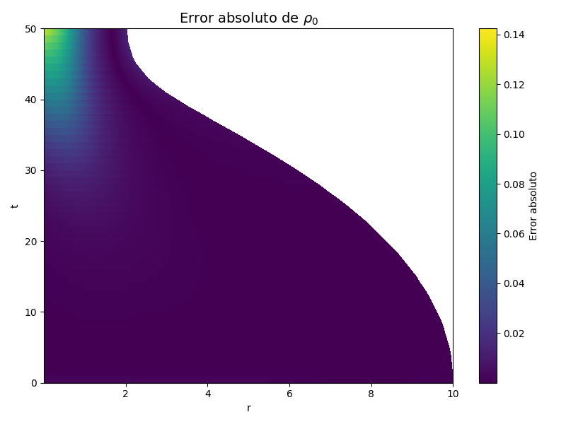

# Physics-Informed Neural Network for Gravitational Collapse

**Bachelor's Thesis in Physics (2025)** | Jorge Hernandez Torres  
**Python · PyTorch · Physics-Informed Neural Networks · Automatic Differentiation · General Relativity**

This academic research project explores whether a **physics-informed neural network (PINN)** can approximate the **Oppenheimer-Snyder gravitational-collapse model**. The model describes the spherical collapse of an idealized, pressureless star and provides analytical reference solutions against which neural-network predictions can be evaluated.

The work combines analytical modeling, nonlinear physical constraints, neural-network design, differentiable residuals, and numerical evaluation. The original thesis was completed as part of a double degree in Mathematics and Physics at the **Universitat de Valencia**, with a Physics thesis grade of **9.4/10**.



*Original project figure: analytical solution (curves) vs. PINN predictions (markers), at different times.*

## Project at a glance

| Component | Approach |
| --- | --- |
| Physical problem | Oppenheimer-Snyder gravitational collapse in spherical symmetry |
| Learning approach | Continuous-time physics-informed neural network |
| Model inputs | Time and radial coordinate |
| Thesis outputs | Lapse `alpha`, metric coefficient `X`, rest-mass density `rho0`, fluid velocity `v` |
| Training objective | Initial and boundary conditions, plus five differential-equation residuals |
| Main tools | Python, PyTorch, NumPy, SciPy; MATLAB for analytical reference data |
| Evaluation | Relative L2 errors and comparison with analytical profiles |

## Motivation and method

Instead of fitting labeled observations alone, a PINN uses **automatic differentiation** to calculate derivatives of its predictions and penalizes violations of physical equations. For the relativistic-collapse problem, the thesis involved:

1. Deriving and implementing the governing physical equations and reference solution.
2. Defining a feed-forward neural network for spatiotemporal fields.
3. Constructing physics residuals alongside initial- and boundary-condition losses.
4. Training and comparing model predictions with the analytical solution.
5. Identifying numerical and computational limitations.

The thesis describes a four-hidden-layer network (100 units per layer), SiLU activations, and staged Adam/L-BFGS-B optimization. **Important:** the thesis describes a four-hidden-layer network (100 units per layer), SiLU activations, and staged Adam/L-BFGS-B optimization. The original thesis-output formulation `(alpha, X, rho0, v)` has since been recovered and is preserved in [`research_code/thesis_formulation/`](research_code/thesis_formulation/). A separate experimental formulation `(alpha, m, rho0, v)` is also retained for research provenance; see [Code provenance and limitations](#code-provenance-and-limitations).

## Results: strengths and limitations

The final archived prediction array matches the relative L2 errors reported in the thesis:

| Physical quantity | Relative L2 error | Interpretation |
| --- | ---: | --- |
| Lapse `alpha` | **0.2363** | Captures broad behavior, with noticeable discrepancies |
| Metric coefficient `X` | **0.1505** | Lowest relative error among the reported fields |
| Rest-mass density `rho0` | **10.9334** | Large errors in strongly nonlinear regions |
| Fluid velocity `v` | **0.9997** | Poor quantitative accuracy near extreme collapse |

These values are **not** evidence that the model solves gravitational collapse to high accuracy. In particular, density and velocity remain poorly approximated. The thesis also reports a substantial computational cost (about 4,995 seconds for its final L-BFGS-B stage on a Colab T4 GPU). The project was valuable as an investigation of PINN design and failure modes, not as a faster or more accurate replacement for established solvers.

| Mass profile | Density error |
| --- | --- |
|  |  |

### Reproduce the numerical evaluation

The archived reference and final predictions are included in the repository. No GPU or PyTorch installation is necessary to validate the **saved predictions**.

```bash
python -m venv .venv
# macOS/Linux
source .venv/bin/activate
# On Windows: .venv\Scripts\activate
pip install -r requirements.txt
python scripts/evaluate_saved_predictions.py
```

Expected output (rounded):

```text
alpha   0.236276
X       0.150524
rho0   10.9334
v       0.999722
```

To create new comparison plots from these stored arrays:

```bash
python scripts/evaluate_saved_predictions.py --plot
```

The command saves figures in `outputs/` (ignored by Git). To run the automated numerical checks:

```bash
python -m unittest discover -s tests -v
```

### Recovered thesis formulation

The original 2025 source code for the thesis-output formulation `(alpha, X, rho0, v)` is available in [`research_code/thesis_formulation/`](research_code/thesis_formulation/).

A lightweight [smoke test](scripts/smoke_test_thesis_formulation.py) verifies that the recovered model can compute its physics-based loss, backpropagate gradients, and complete an Adam optimization step.

The final archived predictions can be evaluated reproducibly. However, a full reproduction of the original training remains unverified. The historical training script is preserved for research provenance rather than presented as a ready-to-run training pipeline.

## Repository structure

```text
assets/                  Original thesis result figures
data/reference/          Analytical reference data (MATLAB .mat)
data/predictions/        Final saved PINN outputs evaluated in the thesis
scripts/                 Reproducible evaluation, plotting and model checks
research_code/           Surviving Python experiment scripts, preserved as supplied
matlab/                  Reference-solution generation scripts, preserved as supplied
tests/                   Validation of the saved predictions
requirements.txt         Lightweight dependencies for evaluation
requirements-training.txt  Additional PyTorch dependency for model inspection
```

## Code provenance and limitations

**The archived final predictions and the surviving model source are not the same experiment.** In the thesis, the network outputs `(alpha, X, rho0, v)`. The preserved `research_code/PINN_OS_4.py` instead outputs `(alpha, m, rho0, v)`, and `research_code/main_3.py` imports an unavailable filename (`PINN_OS`). Some auxiliary scripts also refer to earlier output formats or filenames. They are provided as **historical research artifacts**, not as a verified end-to-end reproduction of the thesis run.

The independently reproducible result in this repository is **evaluation of the supplied final prediction array against the analytical reference grid**. Retraining the exact final model would require recovering or reconstructing the matching training source, hyperparameters and weights. Please do not interpret the archived code as a ready-to-run production library.

For a minimal forward/backward check of the surviving PyTorch variant (not a thesis reproduction):

```bash
pip install -r requirements-training.txt
python scripts/smoke_test_archived_variant.py
```

A small **training-loop sanity check** of the surviving variant is also available:

```bash
python scripts/train_archived_variant.py --epochs 1 --collocation 16 --width 8 --hidden-layers 2
```

This quick run uses randomly initialized parameters and intentionally produces no scientifically meaningful solution. It can expose very large physics residuals; that is expected for an untrained model. You can explicitly choose larger settings, but full scientific training is computationally demanding and does **not** recreate the thesis's final architecture.

The MATLAB scripts document the construction of the reference data. Generating the stored `OS.mat` from scratch requires a compatible MATLAB environment and was not retested for this repository.

## What I learned

- Translating relativistic conservation and metric equations into differentiable optimization objectives.
- Implementing a custom PINN architecture and balancing multiple competing losses.
- Validating scientific ML models against independent analytical solutions.
- Recognizing model failure modes near sharp gradients and relativistic limits.
- Weighing model quality against substantial computational training cost.

**Context:** Academic research project (2025); not a production or commercial deployment. No third-party dataset from a commercial organization is included.
